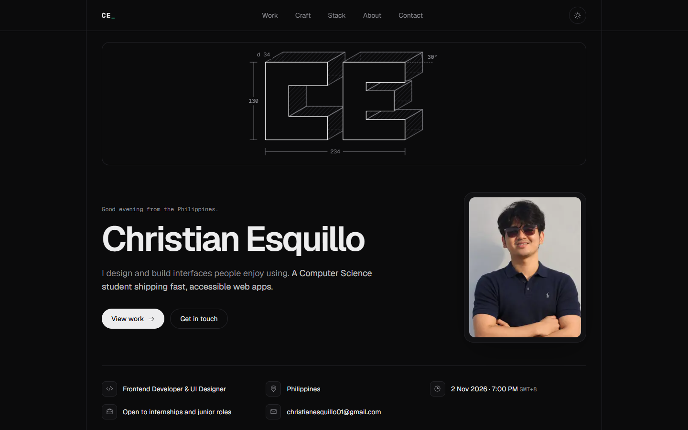

# Christian Esquillo · Portfolio

My personal portfolio: a one-page site that shows the projects I designed and built, the small interface details I care about, and how to reach me.



## Highlights

- **Project detail views** in a native `<dialog>`, with shareable links (`?project=taskbuddy`).
- **Craft section** of live UI demos: a segmented control, a magnetic button, a spring switch and a macOS-style dock.
- **3D line drawing cover**, generated from simple letter outlines (`src/lib/extrude.ts`) and traced in with CSS.
- **Theme switch** that grows the new theme out of the button with the View Transitions API.
- **Reduce motion switch** in the footer, remembered per visitor.
- **GitHub contributions grid**, fetched on the server and cached for a day; it hides itself if the source is down.
- **SEO and sharing:** Open Graph image, sitemap, robots file and Person structured data.

## Stack

Next.js 16 (App Router, Cache Components) · React 19 · TypeScript · Tailwind CSS 4 · Motion · Phosphor Icons · Simple Icons · Vercel Analytics

Tested with Vitest (unit) and Playwright (end-to-end, in Microsoft Edge on desktop and mobile).

## Run locally

Requires Node.js 20.9 or later.

```sh
npm install
npm run dev
```

Open http://localhost:3000.

## Checks

```sh
npm test            # unit tests (Vitest)
npx tsc --noEmit    # types
npm run lint        # ESLint
npm run build       # production build
npm run test:e2e    # browser tests (Playwright, builds must exist first)
```

Browser tests use the installed Microsoft Edge. Set `PLAYWRIGHT_CHANNEL=chrome` to use Chrome instead.

## Editing content

All text, links, projects and the tech stack live in [`src/content/site.ts`](src/content/site.ts). Components only render what is defined there.

- **Photo:** replace `public/profile.jpg`.
- **Resume:** add `public/resume.pdf` and set the resume link's `href` to `"/resume.pdf"`. The button appears automatically.
- **Project screenshots:** `public/projects/<slug>.png` (1280 × 800).

## Deploying

Import the repository in Vercel; no configuration is needed. The production URL is picked up automatically for canonical links and the sitemap. With a custom domain, set `NEXT_PUBLIC_SITE_URL` (for example `https://christianesquillo.dev`).

## Structure

| Path | What lives there |
| --- | --- |
| `src/app` | Page, layout, metadata, icons, Open Graph image, sitemap, robots, 404 |
| `src/components` | One component per section and interaction |
| `src/content/site.ts` | All site content |
| `src/lib` | Pure helpers: time, contributions, 3D extrusion, URL and motion state |
| `tests` | Vitest unit tests |
| `e2e` | Playwright browser tests |
